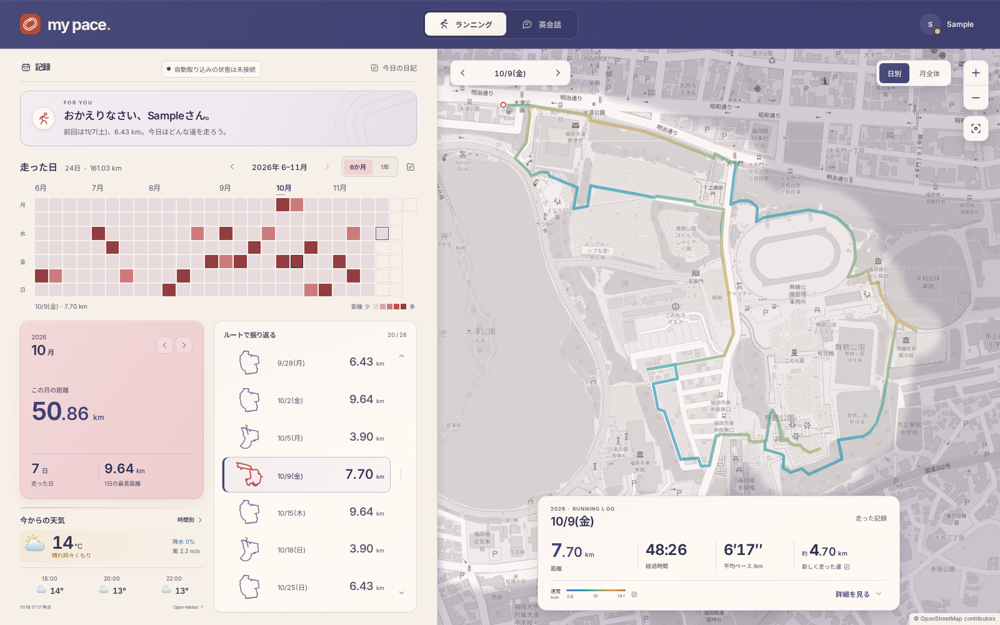
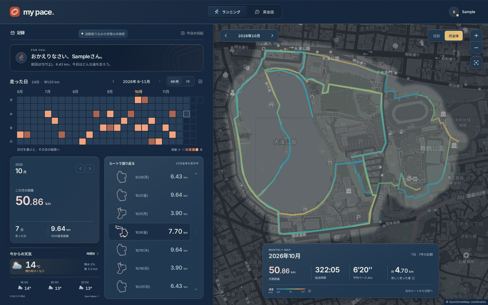

# MyPace

自分が続けたい取り組みを、無理なく続けるための個人用アプリ。使いながら必要な機能を加え、自分に合わせて育てていきます。自分のGoogleアカウント・Drive・Vercelにつないで使う構成です。

作者が自分で使うために作っている、開発途中の趣味プロジェクトです。必要に応じて好きに追加・変更していきます。機能の互換性、更新頻度、サポートは保証しません。



<details>
<summary>夜のテーマ・スマートフォン</summary>




</details>

※ サンプルデータです。

## 現状

現在はランニングから実装を進めています。英会話なども独立した取り組みとして追加し、日記は取り組みを横断して使える構成を目指しています。

- ランニング：地図、速度別の経路表示、継続カレンダー、月間集計、ペース分析。
- 探索：走った道と囲まれた範囲を明るく表示。その日新しく走った道の距離も推定。
- Google連携：CSVの差分処理・自動取り込み、本人認証付きの閲覧、処理状況の表示。
- 日記・設定：ブラウザ内に保存。Drive保存・端末間同期は未実装。
- 英会話・ホーム：入口のみ。内容はこれから。

## ローカル起動

Node.js 20以上。個人の記録・認証設定は同梱していません。

```bash
npm ci
npm start
```

`http://127.0.0.1:4173` を開きます。ローカルでもDriveを読む場合は `.env.example` を `.env.local` にコピーして設定します。

## 接続・設定メモ

1つのデプロイを1人で使います。Vercel Hobbyの個人・非商用利用とGoogleの無料枠を前提にしています。利用上限はありますが、PCの常時起動は不要です。[Hobbyの条件](https://vercel.com/docs/plans/hobby)

**1. Drive：** 本人所有・非共有で、次のフォルダを用意します。設定に使うのは最上位の `my-pace` のIDです。

```text
my-pace/
└── running/
    ├── raw/       CSV原本
    ├── derived/   表示用JSON
    └── system/    処理状態・キャッシュ
```

**2. Vercel：** 自分のGitHubリポジトリを接続。Frameworkは **Other**、Build Commandは **`npm run build:public`**、Output Directoryは **`dist`**。`vercel.json` に設定済みです。デプロイ後の固定URLを次のOAuth設定に使います。[Git連携](https://vercel.com/docs/git)

**3. Google Cloud：** プロジェクトを作り、Google Drive APIを有効化。Google Auth PlatformでExternalを選び、Testingなら自分をテストユーザーに登録。Web用OAuthクライアントを作り、リダイレクトURIを `https://自分のドメイン/api/google-auth` にします。ローカル用は `http://127.0.0.1:4173/api/google-auth`。権限は `openid`・`email`・`drive.readonly` です。

TestingではこのDrive権限の更新トークンは7日で失効します。継続利用する場合はIn productionへの変更を検討します。個人利用は審査免除の対象ですが、未確認アプリの警告が出る場合があります。[トークン期限](https://developers.google.com/identity/protocols/oauth2#expiration) / [個人利用](https://developers.google.com/identity/protocols/oauth2/production-readiness/brand-verification#personal-use)

**4. 環境変数：** VercelのSettings → Environment VariablesにProduction用として登録し、再デプロイします。

| 変数 | 値 |
| --- | --- |
| `MYPACE_ORIGIN` | `https://自分のドメイン`（末尾 `/` なし） |
| `GOOGLE_CLIENT_ID` | Web用OAuthクライアントID |
| `GOOGLE_CLIENT_SECRET` | そのクライアントシークレット |
| `MYPACE_SESSION_SECRET` | 自分で生成した32文字以上のランダムな秘密値 |
| `MYPACE_ROOT_FOLDER_ID` | Driveの `my-pace` フォルダID |

右上のアカウントからGoogleログインすると、自分の `running/derived/index.json` を読みます。[接続の詳細](processing/running/CONNECT.md)

**5. 表示用データ：** 画面は完成済みのJSONを読みます。CSVは `time,latitude,longitude` 列とUTCのISO日時（末尾 `Z`）を持つ形式に対応。他のセンサー列は読み飛ばします。GPX・FITや任意のアプリのCSVにそのまま対応するものではありません。

手動変換はローカルの `data/raw/` にCSVを置き、`npm run prepare:running -- --input data/raw` を実行します（Linux / WSL、`flock` が必要）。`data/running-display/objects/` 内のハッシュ名JSONをDriveの `derived` 直下へ置き、最後に `data/running-display/index.json` を同じ場所へ置きます。`objects` フォルダは作らず、同名ファイルの重複を避けます。自動取り込みの稼働中は、手動で出力を置き換えません。

**6. Apps Script：** 自動取り込みは約5分ごとに入力を確認し、変更されたCSVを処理します。`npm run prepare:gas-production` で生成した `Code.gs` と `appsscript.json` を自分のApps Scriptへ貼り付け、共通ルートIDを設定します。Webアプリとしてのデプロイは不要です。

**現版の初期準備は、検証手順で作った状態・キャッシュの引き継ぎを前提としています。新規環境へキットを貼るだけでは開始できず、その導入経路はまだ整理途中です。** [実装・設定手順](processing/running/gas/PRODUCTION.md) / [検証記録](processing/running/gas/RESULTS.md)

Webアプリは読み取り専用、Apps Scriptは出力JSONの書き込み権限を使います。OAuth権限自体はDrive全体が対象ですが、コードで入力・出力先を制限しています。[Driveの権限](https://developers.google.com/workspace/drive/api/guides/api-specific-auth)

## 開発メモ

画面は `app.js`・`lib/`・CSS、認証と読み込みは `api/`・`server/`、CSV変換は `processing/running/`。確認用コマンドは `npm test` と `npm run build:public` です。

`build:public` は空のランニングデータを生成し、本人の記録はログイン後に読み込みます。`npm run build` は手元の記録を含み得るローカル専用ビルドなので、公開には使いません。

`data/`・`.env*`（`.env.example` を除く）・CSV・作業用スクリーンショット・個人的なメモ・旧実装はGit対象外です。設定済みApps Scriptキット、GPSを含む表示用JSON、シークレットもコミットしないでください。

本体のライセンスは未設定です。背景地図：© [OpenStreetMap contributors](https://www.openstreetmap.org/copyright)。天気：[Open-Meteo](https://open-meteo.com/)。同梱するLeafletのライセンスは [こちら](assets/vendor/LICENSE.txt)。
