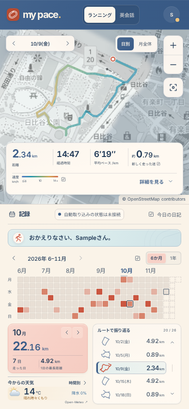

# MyPace

走った道を眺めながら、自分の積み重ねを楽しむための個人用アプリ。
ランニングを中心に、使いながら少しずつ育てています。

[ローカルで動かす](#ローカルで動かす) · [Drive接続](processing/running/CONNECT.md) · [自動取り込み](processing/running/gas/PRODUCTION.md) · [検証結果](processing/running/gas/RESULTS.md)


## 走った記録を、見返したくなる形に

- **ルートから振り返る。** 経路の小さな概形と距離を一覧にし、選ぶと地図・日別の記録が連動します。月全体の経路も重ねられます。
- **積み重ねが見える。** カレンダーの四角は走った距離で色づき、月間距離・走った日数・最長距離をまとめて表示します。
- **走るほど、地図が開く。** 走った道と、その道で囲まれた範囲を明るく表示。「新しく走った道」の推定距離も残します。
- **ペースを色で読む。** 経路は速度に応じた滑らかな色のグラデーション。RUNNING LOGを開くと、ペース推移と区間の詳細を確認できます。
- **時間帯に合わせた配色。** 朝・昼・晩のテーマが自動で切り替わり、好みのテーマに固定することもできます。

PCではページをスクロールせずに使えるよう、画面の高さに応じて余白や表示件数を調整します。細かな情報は必要なときに開き、スマートフォンでは縦の画面に合わせて並べます。

<details>
<summary>夜のテーマ・月全体の表示</summary>


</details>

<details>
<summary>スマートフォンの表示</summary>



</details>

画像は処理済みの実記録をローカルで読み込んだ画面です。天気は表示確認用のサンプルです。元のCSV・GPSデータは、このリポジトリに含めていません。

## データの流れ

大きなCSVを画面を開くたびに読み込まず、Google Apps Scriptで軽い表示用JSONに変換します。WebアプリはGoogleで本人認証した後、その完成済みデータを読み込みます。

```text
Google Drive: my-pace/
└── running/
    ├── raw/       CSV原本。読み取りのみ
    ├── derived/   地図・集計・探索範囲などの表示用JSON
    └── system/    再開用の処理状態とキャッシュ

raw → Apps Scriptで差分処理 → derived/index.json → 本人認証 → MyPace
```

変更の検出にはDriveのメタデータを使い、未変更のCSV本文は再取得しません。処理は中断・再開でき、必要な出力がそろってから目次の `index.json` を更新します。PCを常時起動する必要はなく、Vercel Hobbyと個人Googleアカウントの無料枠での運用を前提にしています。

Google実環境では、約102MBのCSV3件、差分更新12段階、24時間のアイドル監視、新しいCSV1件の取り込みを確認しました。本人認証付きでの本番画面への読み込みも確認済みです。詳しい条件・計測値は [検証結果](processing/running/gas/RESULTS.md) に記録しています。

## 現在できること・これから

| 機能 | 状態 |
| --- | --- |
| 地図・カレンダー・集計・探索表示 | 実装済み |
| Googleログイン・Driveの完成済みデータの表示 | 本番画面で確認済み |
| CSVの継続取り込み | 本番用準備は実機で完了。残りの変換・継続運用は開始操作後に確認 |
| 取り込み状態 | 反映件数・上限回復待ち・再開予定・エラーを表示。更新版Apps Scriptとの接続はこれから |
| 日記・呼び名・テーマ | 利用中のブラウザーに保存 |
| 日記・設定のDrive保存、端末間の自動同期 | 未実装 |
| ホーム・英会話 | カテゴリの入口のみ。内容は準備中 |

## ローカルで動かす

Node.js 20以上を使用します。

```bash
npm ci
npm start
```

`http://127.0.0.1:4173/#records` を開きます。個人の記録は同梱していないため、初期状態ではスクリーンショットの記録は表示されません。Drive接続には [.env.example](.env.example) と [接続手順](processing/running/CONNECT.md) を使って本人のGoogle認証を設定します。

手元の記録を読む検証用モードは `http://127.0.0.1:4173/?source=local#records` です。読み込み先の `data/running.json` はGitから除外しています。

```bash
npm test
npm run build:public
```

`build:public` は必ず空のランニングデータ `{"days":[]}` を生成します。Vercelでもこのコマンドを使います。ログイン後の個人データは、本人所有・非共有の許可したDriveフォルダから読み取り専用APIで取得します。未認証・別アカウントからは取得できません。

`npm run build` はローカル専用です。手元に記録があれば出力に含むため、その `dist/` を公開しないでください。

## 開発と運用の資料

| 資料 | 内容 |
| --- | --- |
| [画面接続](processing/running/CONNECT.md) | Google認証・共通管理フォルダ・Vercelの設定と戻し方 |
| [本番取り込み](processing/running/gas/PRODUCTION.md) | CSV取り込み元・出力先・初回処理・継続更新・ロールバック |
| [データ処理](processing/running/README.md) | 表示用データの形式と生成処理 |
| [Google実測結果](processing/running/gas/RESULTS.md) | 合格した検証と、その範囲・制約 |

画面は `app.js`・`lib/`・`styles.css`、認証とDrive読み込みは `api/`・`server/`、CSVの変換は `processing/running/` に分けています。UIはJavaScript・CSS、地図はLeafletを使用しています。

## リポジトリの保存範囲

このリポジトリは非公開で運用します。コード・合成データを使うテスト・手順書・紹介画像を保存しています。`media/` の画像はREADME用で、アプリの公開ビルドには含めません。

個人の記録を含む `data/`、作業中の `screenshots/`、個人的なメモの `docs/`、旧実装の `旧my-pace/`、環境変数・認証情報・CSV・GPS交換ファイルはGitから除外しています。

背景地図・地図画像：© [OpenStreetMap contributors](https://www.openstreetmap.org/copyright)。天気：[Open-Meteo](https://open-meteo.com/)。同梱するLeafletのライセンスは [こちら](assets/vendor/LICENSE.txt) です。
